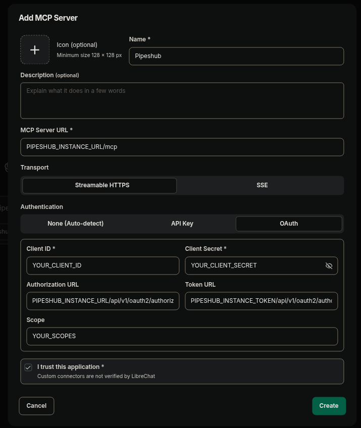

# Connecting MCP Clients to PipesHub MCP Server

This guide covers how to connect PipesHub's remote MCP server to **Cursor**, **Claude Code**, **Gemini CLI**, **Codex CLI**, **Claude.ai (Web)**, and **LibreChat** using static OAuth credentials or bearer tokens.

PipesHub exposes a remote MCP endpoint over **Streamable HTTP** at `/mcp`. MCP Clients connect to this endpoint directly -- no local npm packages or stdio processes needed.

[](https://youtu.be/VgyND38QZ7w)

**[▶ Watch the 2½-minute demo](https://youtu.be/VgyND38QZ7w)**: Claude Code using this MCP server to answer from Jira, Slack, GitHub and Drive, with each person's own permissions.

> **Coding agent?** Start at [For coding agents](https://docs.pipeshub.com/for-agents.md). Install the skill into the *user's* repo with `npx skills add pipeshub-ai/mcp-server` (see [`skills/pipeshub`](./skills/pipeshub/SKILL.md)) and append the `AGENTS.md` snippet on that page. Listed on the [official MCP registry](https://registry.modelcontextprotocol.io) as `io.github.pipeshub-ai/mcp` and on [Cursor Directory](https://cursor.directory/plugins/mcp-server-3) as PipesHub. The listing files (`plugin.json`, `mcp.json`) default MCP to `http://localhost:3000/mcp` (Docker). Change the URL for a company instance; they contain no secrets. Contributors working in this repository: read [AGENTS.md](./AGENTS.md).
>
> **Claude Code plugin:** `/plugin marketplace add pipeshub-ai/mcp-server`, then `/plugin install pipeshub@pipeshub`, adds the MCP server, the skill, and the `/pipeshub:ask` and `/pipeshub:setup` commands. It connects to `${PIPESHUB_MCP_URL:-https://app.pipeshub.com/mcp}` with `Authorization: Bearer ${PIPESHUB_MCP_TOKEN}`; export both in your shell (self-hosted: set the URL to `https://<your-instance>/mcp`), then restart Claude Code.

> **Cursor plugin:** a Cursor team admin imports this repository as a team marketplace (Import from Repo; `.cursor-plugin/marketplace.json`, plugin in [`cursor-plugin/`](./cursor-plugin/README.md)) to add the local MCP server, the docs search server, the skill, and the `ask` and `setup` commands. Sign in once with `pipeshub login`; no token goes in the config.
>
> **Looking for the tool reference?** See [TOOLS.md](./TOOLS.md) for descriptions, arguments, and a decision guide for each tool the MCP server exposes (`pipeshub_chat`, `pipeshub_search`, `pipeshub_get_record_content`, `pipeshub_download_record`, `pipeshub_directory`, `pipeshub_sources`, `pipeshub_agents`). Searching and reading records is the recommended default; `pipeshub_chat` is optional (see [Leaving `pipeshub_chat` out](#leaving-pipeshub_chat-out)).
>
> **Using QM?** QM cannot attach a third-party MCP endpoint — it is an MCP *server* to its own harness, not a client. Follow [Use PipesHub with QM](./qm/docs/use-with-qm.md). The deployment-layer bundle in [`qm/`](./qm/) gives agents a `pipeshub` command inside their sandbox; this package ships that command as a second bin.

## Prerequisites

- A running PipesHub instance: [PipesHub Cloud](https://app.pipeshub.com) or self-hosted. To self-host, the [local Docker demo](https://docs.pipeshub.com/for-agents-local-demo.md) playbook covers install and first-run — do not scaffold LangChain. First-run (account + LLM) is still in the browser; search 500s until an LLM is configured.
- Depending on the client, an OAuth app created in PipesHub (see [Step 1](#step-1-create-an-oauth-app-in-pipeshub)) or a [personal access token](https://docs.pipeshub.com/developer/personal-access-tokens) (`phpat_…`). Claude Code takes a token directly; Claude.ai and the Claude Desktop custom connector need neither on PipesHub 1.2.0 and later (each person signs in, and Claude registers itself).

## Step 1: Create an OAuth App in PipesHub

1. Log in to your PipesHub instance as an admin
2. Navigate to **Settings > Developer Settings > OAuth Apps**
3. Click **Create OAuth App**
4. Fill in the app details:
   - **Name**: e.g., `MCP Integration`
   - **Redirect URIs**: Add all the redirect URIs for the clients you plan to use:

     | Client | Redirect URI |
     |---|---|
     | **Cursor** | `cursor://anysphere.cursor-mcp/oauth/callback` |
     | **Claude Code** | `http://localhost:<PORT>/callback` (e.g., `http://localhost:8080/callback`) |
     | **Claude.ai (Web)** | `https://claude.ai/api/mcp/auth_callback` |
     | **Gemini CLI** | `http://localhost:7777/oauth/callback` |
     | **LibreChat** | `http://localhost:3080/api/mcp/<server-identifier>/oauth/callback` |

> **Important:** Grant your OAuth app every scope the discovery endpoint lists (see [Customizing Default Scopes](#customizing-default-scopes)). Sign-in grants the requested scopes the app allows and drops the rest, so a scope missing from the app does not fail the login; the tools that need it are refused. If the app allows none of the requested scopes, or a requested scope name is unknown, sign-in fails with `invalid_scope`.

5. Save the app and copy the **Client ID** and **Client Secret**

### Customizing Default Scopes

The `/.well-known/oauth-protected-resource/mcp` discovery endpoint lists the scopes the MCP tools use, so clients like Claude Code, which request every listed scope, ask only for what the tools need:

| Scope | Used by |
| --- | --- |
| `semantic:write` | `pipeshub_search` |
| `conversation:chat` | `pipeshub_chat` |
| `agent:read`, `agent:execute` | `pipeshub_agents`, `pipeshub_sources`, `pipeshub_chat` with an agent |
| `kb:read`, `connector:read`, `config:read` | `pipeshub_sources`, `pipeshub_get_record_content`, `pipeshub_download_record`, `pipeshub_indexing_status` |
| `kb:write`, `kb:upload` | `pipeshub_create_collection`, `pipeshub_upload` |
| `connector:write`, `connector:sync` | `pipeshub_add_web_source` |
| `user:read`, `team:read`, `usergroup:read` | `pipeshub_directory` |
| `code:read` | The `pipeshub_code_*` tools |

Discovery also lists `offline_access`. It is not a tool scope: it lets the client get a refresh token, so it stays signed in instead of signing in again when its access token expires.

The list is limited to the [`MCP_SCOPES`](https://github.com/pipeshub-ai/pipeshub-ai/blob/main/backend/env.template) environment variable on your PipesHub instance, which is also the upper limit on the scopes any personal access token or OAuth token can hold. Remove a scope from `MCP_SCOPES` to stop discovery listing it. Clients that set their own scopes, such as Cursor and LibreChat, still request it, but PipesHub does not grant a scope that `MCP_SCOPES` excludes. PipesHub servers older than this behavior list all of `MCP_SCOPES`.

## Placeholders

Replace these in all configurations below:

| Placeholder | Description | Example |
|---|---|---|
| `PIPESHUB_INSTANCE_URL` | Your PipesHub instance URL | `https://app.pipeshub.com` |
| `YOUR_CLIENT_ID` | OAuth app client ID | `clid_abc123...` |
| `YOUR_CLIENT_SECRET` | OAuth app client secret | `clsec_xyz789...` |

The remote MCP endpoint URL is: `PIPESHUB_INSTANCE_URL/mcp`

---

## Remote MCP Setup

<details>
<summary><strong>Cursor</strong></summary>

Cursor supports static OAuth for remote MCP servers via the `auth` object in `mcp.json`.

### Configuration

Open Cursor Settings > Tools and Integrations > New MCP Server, or edit your project's `.cursor/mcp.json`:

```json
{
  "mcpServers": {
    "pipeshub": {
      "url": "PIPESHUB_INSTANCE_URL/mcp",
      "auth": {
        "CLIENT_ID": "YOUR_CLIENT_ID",
        "CLIENT_SECRET": "YOUR_CLIENT_SECRET",
        "scopes": [
          "org:read", "org:write", "org:admin",
          "user:read", "user:write", "user:invite", "user:delete",
          "usergroup:read", "usergroup:write",
          "team:read", "team:write",
          "kb:read", "kb:write", "kb:delete", "kb:upload",
          "semantic:read", "semantic:write", "semantic:delete",
          "conversation:read", "conversation:write", "conversation:chat",
          "agent:read", "agent:write", "agent:execute",
          "connector:read", "connector:write", "connector:sync", "connector:delete",
          "config:read", "config:write",
          "document:read", "document:write", "document:delete",
          "crawl:read", "crawl:write", "crawl:delete"
        ]
      }
    }
  }
}
```

Cursor will auto-discover the authorization and token endpoints via PipesHub's `/.well-known/oauth-protected-resource/mcp` metadata.

> **Note:** If the `scopes` field is omitted, Cursor fetches `/.well-known/oauth-protected-resource/mcp` and requests **all** `scopes_supported` listed there. To limit access, explicitly list only the scopes you need. You can also control which scopes are exposed server-side — see [Customizing Default Scopes](#customizing-default-scopes).

### Using Environment Variables

Use Cursor's `${env:VAR}` interpolation to keep secrets out of config files:

```json
{
  "mcpServers": {
    "pipeshub": {
      "url": "${env:PIPESHUB_INSTANCE_URL}/mcp",
      "auth": {
        "CLIENT_ID": "${env:PIPESHUB_CLIENT_ID}",
        "CLIENT_SECRET": "${env:PIPESHUB_CLIENT_SECRET}",
        "scopes": [
          "kb:read", "kb:write",
          "semantic:read", "semantic:write",
          "conversation:read", "conversation:write", "conversation:chat",
          "agent:read", "agent:write", "agent:execute",
          "connector:read", "connector:write",
          "config:read", "user:read"
        ]
      }
    }
  }
}
```

### Redirect URI

Cursor uses a fixed redirect URI for all MCP servers:

```
cursor://anysphere.cursor-mcp/oauth/callback
```

Register this as the allowed redirect URI when creating the OAuth app in PipesHub.

### OAuth Login Troubleshooting

If Cursor's internal browser fails to load the OAuth login page, copy the authorization URL from the internal browser and paste it into your normal browser to complete the login flow.

</details>

<details>
<summary><strong>Claude Code</strong></summary>

### With a personal access token (recommended for your own use)

No OAuth app and no admin needed, and results follow your own permissions.

1. In PipesHub, open **Workspace settings → Developer settings → Personal access tokens → New token**, and copy the token (it appears only once). Export the URL and the token in your shell. `read -rs` takes the token without echoing it or saving it in your shell history:

   ```bash
   export PIPESHUB_MCP_URL=https://your-instance/mcp
   read -rs PIPESHUB_MCP_TOKEN   # paste the phpat_... token, then press Enter
   export PIPESHUB_MCP_TOKEN
   ```

   The URL must be `https://` unless PipesHub runs on your own machine (`http://localhost:3000/mcp` is fine): the token is sent as a bearer header on every request. To keep the token across sessions, load it from your OS keychain or a secrets manager in your shell profile rather than writing it there in plain text.

2. Add the server:

   ```bash
   claude mcp add --transport http --scope user pipeshub "$PIPESHUB_MCP_URL" \
     --header 'Authorization: Bearer ${PIPESHUB_MCP_TOKEN}'
   ```

   Keep the single quotes: Claude Code stores `${PIPESHUB_MCP_TOKEN}` as written and reads the token from its environment each time it connects, so the token never lands in its config. Start Claude Code from a shell where the variable is exported. Drop `--scope user` to add it to the current project only.

3. Check it with `claude mcp list`; `pipeshub` should show as connected.

For a checked-in `.mcp.json`, reference the variables instead of the token:

```json
{
  "mcpServers": {
    "pipeshub": {
      "type": "http",
      "url": "${PIPESHUB_MCP_URL}",
      "headers": {
        "Authorization": "Bearer ${PIPESHUB_MCP_TOKEN}"
      }
    }
  }
}
```

The [Claude Code plugin](#connecting-mcp-clients-to-pipeshub-mcp-server) reads the same two variables.

### With an OAuth app (shared or admin-managed setups)

Claude Code supports remote HTTP MCP servers with static OAuth credentials via `--client-id`, `--client-secret`, and `--callback-port`.

PipesHub exposes discovery at `/.well-known/oauth-protected-resource/mcp`, so Claude Code auto-discovers the authorization and token endpoints.

> **Important:** Claude Code does **not** support configuring specific scopes. It fetches `/.well-known/oauth-protected-resource/mcp`, reads the `scopes_supported` list, and requests **all** of them. PipesHub lists only the scopes the MCP tools use. Give your OAuth app all of them: sign-in grants the ones the app allows, tools that need a missing scope are refused, and sign-in fails with `invalid_scope` if the app allows none of them. To see or limit the list, see [Customizing Default Scopes](#customizing-default-scopes).

### Add with CLI

```bash
claude mcp add --transport http \
  --client-id YOUR_CLIENT_ID \
  --client-secret \
  --callback-port 8080 \
  pipeshub PIPESHUB_INSTANCE_URL/mcp
```

> `--client-secret` without a value prompts for masked input. To skip the prompt, set the `MCP_CLIENT_SECRET` environment variable:
>
> ```bash
> MCP_CLIENT_SECRET=YOUR_CLIENT_SECRET claude mcp add --transport http \
>   --client-id YOUR_CLIENT_ID \
>   --client-secret \
>   --callback-port 8080 \
>   pipeshub PIPESHUB_INSTANCE_URL/mcp
> ```

To make it available across all projects:

```bash
claude mcp add --transport http --scope user \
  --client-id YOUR_CLIENT_ID \
  --client-secret \
  --callback-port 8080 \
  pipeshub PIPESHUB_INSTANCE_URL/mcp
```

### Add with JSON

```bash
claude mcp add-json pipeshub '{
  "type": "http",
  "url": "PIPESHUB_INSTANCE_URL/mcp",
  "oauth": {
    "clientId": "YOUR_CLIENT_ID",
    "callbackPort": 8080
  }
}' --client-secret
```

### Project-Scoped (`.mcp.json`)

Create a `.mcp.json` file in your project root. This can be committed to version control (secrets stay out via env vars):

```json
{
  "mcpServers": {
    "pipeshub": {
      "type": "http",
      "url": "${PIPESHUB_INSTANCE_URL}/mcp",
      "oauth": {
        "clientId": "${PIPESHUB_CLIENT_ID}",
        "callbackPort": 8080
      }
    }
  }
}
```

Set environment variables before launching Claude Code:

```bash
export PIPESHUB_INSTANCE_URL="https://app.pipeshub.com"
export PIPESHUB_CLIENT_ID="your-client-id"
```

> **Note:** The client secret is stored in the system keychain, not in config files. You'll be prompted to enter it when you first authenticate via `/mcp`.

### Authenticate

After adding the server, run `/mcp` inside Claude Code and follow the browser login flow. Tokens are stored securely and refreshed automatically.

### Verify

```bash
claude mcp list
claude mcp get pipeshub
```

</details>

<details>
<summary><strong>Gemini CLI</strong></summary>

Gemini CLI supports remote MCP servers with OAuth via `dynamic_discovery` (the default), which auto-discovers authorization and token endpoints from PipesHub's `/.well-known/oauth-protected-resource/mcp`.

### Option A: Settings File

Edit `~/.gemini/settings.json`:

```json
{
  "mcpServers": {
    "pipeshub": {
      "url": "PIPESHUB_INSTANCE_URL/mcp",
      "oauth": {
        "clientId": "YOUR_CLIENT_ID",
        "clientSecret": "YOUR_CLIENT_SECRET",
        "scopes": [
          "org:read", "org:write", "org:admin",
          "user:read", "user:write", "user:invite", "user:delete",
          "usergroup:read", "usergroup:write",
          "team:read", "team:write",
          "kb:read", "kb:write", "kb:delete", "kb:upload",
          "semantic:read", "semantic:write", "semantic:delete",
          "conversation:read", "conversation:write", "conversation:chat",
          "agent:read", "agent:write", "agent:execute",
          "connector:read", "connector:write", "connector:sync", "connector:delete",
          "config:read", "config:write",
          "document:read", "document:write", "document:delete",
          "crawl:read", "crawl:write", "crawl:delete"
        ]
      }
    }
  }
}
```

> **Note:** Adjust the `scopes` list to match what your OAuth app was granted. If you only need a subset of tools, you can limit the scopes accordingly.

### Option B: CLI Command

```bash
gemini mcp add --transport http pipeshub PIPESHUB_INSTANCE_URL/mcp
```

Then edit `~/.gemini/settings.json` to add the `oauth` block as shown above.

### Authenticate

Inside Gemini CLI, use the `/mcp auth` commands:

```bash
# List servers and their auth status
/mcp auth

# Authenticate with PipesHub (opens browser for login)
/mcp auth pipeshub

# Re-authenticate if tokens expire
/mcp auth pipeshub
```

On first connection, Gemini will automatically detect the 401 response, discover the OAuth endpoints, and open a browser for login. Tokens are stored securely in `~/.gemini/mcp-oauth-tokens.json` and refreshed automatically.

### Manage Servers

```bash
# List all configured servers
gemini mcp list

# Remove the server
gemini mcp remove pipeshub

# Temporarily disable/enable
gemini mcp disable pipeshub
gemini mcp enable pipeshub
```

### OAuth Configuration Properties

| Property | Required | Description |
|---|---|---|
| `clientId` | Yes | OAuth 2.0 Client ID from PipesHub |
| `clientSecret` | No | OAuth 2.0 Client Secret (for confidential clients) |
| `scopes` | No | OAuth scopes to request |
| `authorizationUrl` | No | Override authorization endpoint (auto-discovered by default) |
| `tokenUrl` | No | Override token endpoint (auto-discovered by default) |
| `redirectUri` | No | Override redirect URI (defaults to `http://localhost:7777/oauth/callback`) |

> **Note:** OAuth requires a local browser. It will not work in headless environments, remote SSH without X11 forwarding, or containers without browser access.

</details>

<details>
<summary><strong>Codex CLI</strong></summary>

Codex CLI ([OpenAI Codex](https://developers.openai.com/codex/mcp)) connects to remote MCP servers over **Streamable HTTP**, configured with a `[mcp_servers.<name>]` table in `~/.codex/config.toml` (or `.codex/config.toml` in your project root to scope it per-project). Codex's HTTP transport authenticates with a **bearer token** read from an environment variable, so pass a PipesHub JWT bearer token.

```toml
[mcp_servers.pipeshub]
url = "PIPESHUB_INSTANCE_URL/mcp"
bearer_token_env_var = "PIPESHUB_BEARER_TOKEN"
```

`bearer_token_env_var` is the **name** of the environment variable that holds the token — export it before launching Codex:

```bash
export PIPESHUB_BEARER_TOKEN="YOUR_BEARER_TOKEN"
```

> The token is the raw JWT, without the `Bearer` keyword.

Or add it with the CLI:

```bash
codex mcp add pipeshub \
  --url PIPESHUB_INSTANCE_URL/mcp \
  --bearer-token-env-var PIPESHUB_BEARER_TOKEN
```

> `--bearer-token-env-var` takes the **name of the environment variable** holding the token, not the token value itself.

### Verify

```bash
# List configured MCP servers
codex mcp list

# Inside the Codex TUI, view server status and available tools
/mcp
```

</details>

<details>
<summary><strong>Claude.ai (Web)</strong></summary>

Claude.ai supports custom connectors via remote MCP servers. This lets you use PipesHub tools directly in the Claude.ai web interface without any local setup. It needs **public HTTPS**: Claude connects from Anthropic's servers, so `localhost` won't work. Free plan users are limited to one custom connector. Full guide: [docs.pipeshub.com/mcp/claude-ai](https://docs.pipeshub.com/mcp/claude-ai).

The **Add custom connector** dialog asks how Claude authenticates:

| Option | What you need | Use it when |
|---|---|---|
| **Sign in now** (recommended) | Nothing. Claude registers itself with PipesHub (dynamic client registration, on by default from PipesHub 1.2.0). | Almost always. Each person signs in as themselves, and tokens refresh on their own. |
| **No sign-in** + request header | A personal access token | Your own individual Claude account. |
| **Sign in now** + your own OAuth app | Client ID and Client Secret | Registration is off on your instance (`PIPESHUB_ENABLE_DCR=false`) or PipesHub is older than 1.2.0. |

### Sign in with your PipesHub account

- **Individual accounts (Free, Pro, Max):** open **Customize > Connectors**, click **+ > Add custom connector**, enter a name and `PIPESHUB_INSTANCE_URL/mcp`, choose **Sign in now**, and click **Add**. Approve the PipesHub sign-in and consent page that opens.
- **Team / Enterprise:** an organization **Owner** opens **Organization settings > Connectors**, clicks **Add > Custom > Web**, enters the URL, chooses **Sign in now**, and clicks **Add**. Each member then opens **Customize > Connectors**, finds PipesHub (marked **Custom**), and clicks **Connect** to sign in as themselves.

### With a personal access token

For an **individual** Claude account only:

1. Mint a token in PipesHub under **Workspace settings → Developer settings → Personal access tokens**.
2. Add the custom connector with the URL, and under **Authentication** choose **No sign-in**.
3. Under **Request headers** (inside **Advanced** if the dialog shows everything on one screen), pick `authorization` and enter the value `Bearer phpat_YOUR_TOKEN` (the word `Bearer`, one space, then the token; Claude sends the value exactly as typed). Keep **Required** ticked and click **Add**.

> **Warning:** don't do this on a Team or Enterprise organization connector. Claude sends the same header for every member, so everyone would search PipesHub as the token's owner. Request headers are a beta feature in Claude; if the section isn't there, use **Sign in now**. Claude doesn't let you view or edit the header later, so when the token expires, remove the connector and add it again.

### With an OAuth app

Create the app as in [Step 1](#step-1-create-an-oauth-app-in-pipeshub) with the redirect URI `https://claude.ai/api/mcp/auth_callback`. When adding the connector, choose **Sign in now**, then enter the client ID and client secret: in a two-step dialog (with a **Continue** button) under **OAuth client > Use your own OAuth client**, in a one-screen dialog under **Advanced**.

### Troubleshooting

- **"Couldn't reach" the server:** `curl -X POST PIPESHUB_INSTANCE_URL/mcp` from outside your network should return `401`. If PipesHub is behind a firewall, WAF or bot protection (such as Cloudflare), allow Anthropic's outbound ranges `160.79.104.0/21` and `153.61.208.0/20` for `/mcp`, `/.well-known/*` and `/api/v1/oauth2/*`. See [Anthropic's IP addresses](https://platform.claude.com/docs/en/api/ip-addresses) for the current list.
- **Every call returns 401 with a token:** the header value must start with `Bearer `, and the token must not be expired or revoked.

### Security Notes

- Only connect to trusted MCP servers
- Review the permissions requested on the PipesHub consent page
- With **Sign in now**, Claude.ai acts on your behalf with an OAuth token — your password is never shared
- A personal access token acts as you wherever it is used; revoke it from **Personal access tokens** if it leaks

</details>

<details>
<summary><strong>LibreChat</strong></summary>

LibreChat supports remote MCP servers with OAuth authentication via its custom connectors UI. This lets you connect PipesHub tools to any model available in your LibreChat instance.



### Configuration

1. Log in to your LibreChat instance
2. Navigate to **MCP Servers** settings panel
3. Click **Add** to create a new custom MCP connector
4. Fill in the connector details:
   - **Name**: `Pipeshub` (or any name you prefer)
   - **MCP Server URL**: `PIPESHUB_INSTANCE_URL/mcp`
   - **Transport**: Select **Streamable HTTPS** 
   - **Authentication**: Select **OAuth**
5. Enter your OAuth credentials:
   - **Client ID**: `YOUR_CLIENT_ID`
   - **Client Secret**: `YOUR_CLIENT_SECRET`
   - **Authorization URL**: `PIPESHUB_INSTANCE_URL/api/v1/oauth2/authorize`
   - **Token URL**: `PIPESHUB_INSTANCE_URL/api/v1/oauth2/token`
   - **Scope**: `openid email` (or additional scopes as needed)
6. Check **I trust this application**
7. Click **Add** to save the connector
8. After adding, LibreChat will generate a **Redirect URI** displayed in the connector settings panel (next to the copy button). It follows this format:
   ```
   http://localhost:3080/api/mcp/<server-identifier>/oauth/callback
   ```
9. **Copy the Redirect URI** and register it as an allowed redirect URI in your PipesHub OAuth app (see [Step 1](#step-1-create-an-oauth-app-in-pipeshub))
10. Return to the LibreChat connector and click **Update** to initiate the OAuth flow — you'll be redirected to PipesHub's login page to authenticate and grant permissions

### Redirect URI

LibreChat generates the redirect URI **after** the connector is created. The URI follows this format:

```
http://localhost:3080/api/mcp/<server-identifier>/oauth/callback
```

Where `<server-identifier>` is the unique identifier assigned by LibreChat (visible at the top of the connector settings as "Unique Server Identifier"). You must copy this URI and add it to your PipesHub OAuth app's allowed redirect URIs **before** authenticating.

> **Note:** If your LibreChat instance runs on a different host or port, the URI will reflect that (e.g., `https://chat.example.com/api/mcp/pipeshub/oauth/callback`).

### Scopes

LibreChat allows you to specify the OAuth scopes in the **Scope** field. Use a space-separated list:

```
openid email
```

To request PipesHub-specific scopes, add them to the scope field:

```
openid email org:read kb:read kb:write semantic:read conversation:read conversation:write conversation:chat agent:read agent:execute
```

> **Note:** Sign-in grants only the requested scopes your OAuth app in PipesHub allows, so request the scopes the app was granted. See [Customizing Default Scopes](#customizing-default-scopes) for details.

</details>

---

## Local MCP Server (Stdio)

Instead of connecting to PipesHub's remote MCP endpoint, you can run the MCP server locally as a stdio process using the `@pipeshub-ai/mcp` npm package. This is useful when you prefer a local setup or need to work in environments where direct HTTP connections to the remote MCP endpoint aren't practical.

### Prerequisites

- Node.js 18+ installed
- A PipesHub instance URL
- A credential that acts as you, so results follow your permissions. Either:
  - **No token in the config:** run `pipeshub login` once (`npm i -g @pipeshub-ai/mcp`; `--url <origin>` when self-hosted). With no `--bearer-auth`, `start` uses that sign-in, refreshes it (on PipesHub versions that issue device-login refresh tokens; otherwise it lasts an hour), and defaults `--server-url` to the instance you signed in to. It also reads `PIPESHUB_TOKEN` from the environment, sent only to `--server-url` or `PIPESHUB_BASE_URL`.
  - **No account yet:** `pipeshub init --client <name>` creates a trial workspace on instances that offer them (PipesHub Cloud by default; it stays open for 3 days), signs the CLI in to it the same way, and adds PipesHub to that client. Add files with `pipeshub collection create` and `pipeshub upload`. It will not replace an existing sign-in without `--force`. When the instance returns a claim link, `init` prints it (and `pipeshub auth status` shows it again): the person who opens it becomes the workspace's admin and keeps it, and the CLI then signs in as them with `pipeshub login --url <origin> --no-wait` and `pipeshub login --wait`.
  - **A [personal access token](https://docs.pipeshub.com/developer/personal-access-tokens)** (`phpat_…`), minted in PipesHub under Developer Settings and passed as `--bearer-auth`, as in the examples below.

With `pipeshub login`, a Claude Desktop entry is just:

```json
{
  "mcpServers": {
    "pipeshub": {
      "command": "npx",
      "args": ["@pipeshub-ai/mcp", "start"]
    }
  }
}
```

### Placeholders

Replace these in all configurations below:

| Placeholder | Description | Example |
|---|---|---|
| `PIPESHUB_INSTANCE_URL` | Your PipesHub instance URL | `https://app.pipeshub.com` |
| `YOUR_BEARER_TOKEN` | Your personal access token | `phpat_...` |

<details>
<summary><strong>Claude Desktop</strong></summary>

Configure in Claude Desktop settings (`claude_desktop_config.json`):

```json
{
  "mcpServers": {
    "pipeshub": {
      "command": "npx",
      "args": [
        "@pipeshub-ai/mcp",
        "start",
        "--server-url",
        "PIPESHUB_INSTANCE_URL",
        "--bearer-auth",
        "YOUR_BEARER_TOKEN"
      ]
    }
  }
}
```

</details>

<details>
<summary><strong>Cursor (Local)</strong></summary>

Open Cursor Settings > Tools and Integrations > New MCP Server, or edit your project's `.cursor/mcp.json`:

```json
{
  "mcpServers": {
    "pipeshub": {
      "command": "npx",
      "args": [
        "@pipeshub-ai/mcp",
        "start",
        "--server-url",
        "PIPESHUB_INSTANCE_URL",
        "--bearer-auth",
        "YOUR_BEARER_TOKEN"
      ]
    }
  }
}
```

</details>

<details>
<summary><strong>Claude Code CLI (Local)</strong></summary>

```bash
claude mcp add pipeshub -- npx -y @pipeshub-ai/mcp start \
  --server-url PIPESHUB_INSTANCE_URL \
  --bearer-auth YOUR_BEARER_TOKEN
```

</details>

<details>
<summary><strong>Gemini CLI (Local)</strong></summary>

```bash
gemini mcp add pipeshub -- npx -y @pipeshub-ai/mcp start \
  --server-url PIPESHUB_INSTANCE_URL \
  --bearer-auth YOUR_BEARER_TOKEN
```

</details>

<details>
<summary><strong>Codex CLI (Local)</strong></summary>

Run the MCP server as a local stdio process with your personal access token. Edit `~/.codex/config.toml` (or `.codex/config.toml` in your project root):

```toml
[mcp_servers.pipeshub]
command = "npx"
args = [
  "-y",
  "@pipeshub-ai/mcp",
  "start",
  "--server-url",
  "PIPESHUB_INSTANCE_URL",
  "--bearer-auth",
  "YOUR_BEARER_TOKEN",
]
```

</details>

<details>
<summary><strong>VS Code</strong></summary>

Open Command Palette > `MCP: Open User Configuration`, then add:

```json
{
  "mcpServers": {
    "pipeshub": {
      "command": "npx",
      "args": [
        "@pipeshub-ai/mcp",
        "start",
        "--server-url",
        "PIPESHUB_INSTANCE_URL",
        "--bearer-auth",
        "YOUR_BEARER_TOKEN"
      ]
    }
  }
}
```

</details>

<details>
<summary><strong>Windsurf</strong></summary>

Open Windsurf Settings > Cascade > Manage MCPs > View raw config, then add:

```json
{
  "mcpServers": {
    "pipeshub": {
      "command": "npx",
      "args": [
        "@pipeshub-ai/mcp",
        "start",
        "--server-url",
        "PIPESHUB_INSTANCE_URL",
        "--bearer-auth",
        "YOUR_BEARER_TOKEN"
      ]
    }
  }
}
```

</details>

<details>
<summary><strong>Running from Source (Development)</strong></summary>

To run the local MCP server from a cloned repository instead of the npm package:

```bash
git clone https://github.com/pipeshub-ai/pipeshub-ai.git
cd pipeshub-ai
npm install
npm run build
node ./bin/mcp-server.js start --server-url PIPESHUB_INSTANCE_URL --bearer-auth YOUR_BEARER_TOKEN
```

For MCP client configuration, replace `npx @pipeshub-ai/mcp` with `node ./bin/mcp-server.js`:

```json
{
  "mcpServers": {
    "pipeshub": {
      "command": "node",
      "args": [
        "./bin/mcp-server.js",
        "start",
        "--server-url",
        "PIPESHUB_INSTANCE_URL",
        "--bearer-auth",
        "YOUR_BEARER_TOKEN"
      ]
    }
  }
}
```

To debug with MCP Inspector:

```bash
npx @modelcontextprotocol/inspector node ./bin/mcp-server.js start --server-url PIPESHUB_INSTANCE_URL --bearer-auth YOUR_BEARER_TOKEN
```

</details>

### CLI Help

For a full list of server arguments:

```bash
npx @pipeshub-ai/mcp --help
```

### Local HTTP server

`serve` (and `start --transport sse`) listens on `127.0.0.1` only. Pass `--host 0.0.0.0` to accept connections from other machines. A browser request is answered only when its `Origin` is `localhost`, `127.0.0.1` or `[::1]`; any other origin gets 403. Clients that send no `Origin` (CLIs, desktop apps) are unaffected.

### Retries and Timeouts

The local server (`start` and `serve`) retries a PipesHub request that is refused with 429, 502, 503 or 504. It waits for as long as the `Retry-After` header asks, or, without one, backs off for half a second and then a second. It stops after three tries in all and passes the last answer on. A `Retry-After` of more than 30 seconds is not waited out: that answer is passed on at once, and the tool's error says how long PipesHub asked to wait. Only requests that are safe to repeat are retried (`GET`, `HEAD`, `OPTIONS`, `PUT`, `DELETE`). Search and chat are `POST`s and are never retried, because a repeat would be a second search or a second answer.

A request that gets no response within 60 seconds is abandoned. The limit covers the wait for PipesHub to start answering, not the whole answer, so a long chat response that is already streaming is not cut off.

Both are set with environment variables, in the MCP client's `env` block or with `--env NAME=VALUE`:

| Variable | Default | Meaning |
| --- | --- | --- |
| `PIPESHUB_MCP_MAX_ATTEMPTS` | `3` | Tries per request, the first one included, from 1 to 10. `1` turns retries off. |
| `PIPESHUB_MCP_TIMEOUT_MS` | `60000` | Milliseconds to wait for PipesHub to start answering. `0` turns the timeout off. |

---

## Read-only mode

Three tools write, and none of them delete or overwrite. `pipeshub_create_collection` and `pipeshub_upload` add collections and documents; they need the `kb:write` and `kb:upload` scopes. `pipeshub_add_web_source` sets up a Web connector that crawls a website now and daily; it also needs `connector:write` and `connector:sync` (scope group `connect`). To serve read tools only from the local server, pass `--scope read` to `start` or `serve`. On the remote `/mcp`, a token is offered only the write tools its scopes allow.

---

## Leaving `pipeshub_chat` out

The server offers all eleven tools, and its instructions and tool descriptions tell the agent to answer with `pipeshub_search` and `pipeshub_get_record_content` first. `pipeshub_chat` runs PipesHub's own assistant and is optional: for an agent that can call tools, it adds cost and time without adding accuracy. In PipesHub's evaluation (100 questions, Claude Opus as the agent), search and read alone found 88% of the facts at $0.54 and 78 seconds median per answer; adding chat also found 88%, at about $0.73 and 97 seconds. See [TOOLS.md](./TOOLS.md) for the full figures.

Nothing changes unless you choose to: by default every tool stays. To hold an agent to search and read, leave `pipeshub_chat` out, together with `pipeshub_agents`, which only picks an agent for chat:

- **Local stdio server:** set `PIPESHUB_MCP_CHAT=off` in the server's `env` block in your MCP client config, or pass `--env PIPESHUB_MCP_CHAT=off` to `start` or `serve`. The server then mounts nine tools, and its instructions no longer mention chat or agents. Unset or `on` keeps today's behaviour; any other value stops the server with an error that says what it accepts.

  ```json
  "env": { "PIPESHUB_MCP_CHAT": "off" }
  ```

  To pick tools one by one instead, list the ones to keep with `--tool` (for example `--tool pipeshub_search --tool pipeshub_get_record_content`). `--tool` does not change the instructions.
- **Remote endpoint (`/mcp`):** turn the tool off in the client. In Claude Code, run `claude --disallowedTools "mcp__pipeshub__pipeshub_chat,mcp__pipeshub__pipeshub_agents"`, where `pipeshub` is the name you gave the server, or put the same entries in the `permissions.deny` list of `.claude/settings.json`. In other clients, use the per-tool toggles in their MCP settings, where they offer them.

Keep `pipeshub_chat` when the client cannot run its own tool loop, when you want PipesHub's assistant to write the answer, to talk to a configured PipesHub agent, or to take an action through the user's connected tools.

---

## How It Works

### Architecture

```
AI Client (Cursor / Claude Code / Gemini CLI / Codex CLI / Claude.ai / LibreChat)
        │
        │  HTTP POST (JSON-RPC)
        │  Authorization: Bearer <token>
        ▼
  PIPESHUB_INSTANCE_URL/mcp
        │
        │  StreamableHTTP Transport
        │  (stateless, per-request MCP server)
        ▼
  PipesHub API (curated tool set — see TOOLS.md)
```


### OAuth Protected Resource Discovery

PipesHub exposes OAuth protected resource discovery at:

```
PIPESHUB_INSTANCE_URL/.well-known/oauth-protected-resource/mcp
```

This returns all OAuth endpoints automatically:
- Authorization: `PIPESHUB_INSTANCE_URL/api/v1/oauth2/authorize`
- Token: `PIPESHUB_INSTANCE_URL/api/v1/oauth2/token`
- Revocation: `PIPESHUB_INSTANCE_URL/api/v1/oauth2/revoke`
- JWKS: `PIPESHUB_INSTANCE_URL/.well-known/jwks.json`

---

## Troubleshooting

### "Incompatible auth server: does not support dynamic client registration"
This means the client is trying dynamic registration instead of using your pre-configured credentials. Make sure you passed `--client-id` and `--client-secret` (Claude Code) or the `auth` object (Cursor) correctly.

### Authentication fails / redirect error
- Ensure the **Redirect URI** in your OAuth app matches exactly what the client uses:
  - **Cursor**: `cursor://anysphere.cursor-mcp/oauth/callback`
  - **Claude Code**: `http://localhost:<callbackPort>/callback`
  - **Claude.ai**: `https://claude.ai/api/mcp/auth_callback`
  - **Gemini CLI**: `http://localhost:7777/oauth/callback`
  - **LibreChat**: `http://localhost:3080/api/mcp/<server-identifier>/oauth/callback`
- Make sure the OAuth app is **active** (not suspended) in PipesHub

### Cannot reach MCP endpoint
- Verify the endpoint is accessible: `curl -X POST PIPESHUB_INSTANCE_URL/mcp` (should return 401, not connection error)
- Check that your PipesHub instance has MCP enabled

### Debugging with MCP Inspector
```bash
npx @modelcontextprotocol/inspector
```
Then connect to `PIPESHUB_INSTANCE_URL/mcp` with a Bearer token to test the endpoint directly.

---

## FAQ

<details>
<summary><strong>How do I update the scopes for my MCP integration?</strong></summary>

1. **Update the [`MCP_SCOPES`](https://github.com/pipeshub-ai/pipeshub-ai/blob/main/backend/env.template) environment variable** on your PipesHub instance so it includes the scopes you want clients to get. Discovery lists only the ones the MCP tools use.
2. **Update the OAuth app scopes** in PipesHub: go to **Settings > Developer Settings > OAuth Apps**, select your OAuth app, and add or remove scopes as needed.
3. **Re-authenticate the client** — existing tokens carry the old scopes, so you need to re-authenticate to get a new token with the updated scopes. For example:
   - **Cursor**: Remove and re-add the MCP server, or clear the cached OAuth token and reconnect.
   - **Claude Code**: Run `/mcp` and complete the browser login flow again.
   - **Gemini CLI**: Run `/mcp auth pipeshub` to re-authenticate.
   - **Codex CLI**: Update `PIPESHUB_BEARER_TOKEN` with a fresh token and restart Codex.
   - **Claude.ai**: Disconnect and reconnect the connector in **Settings > Connectors**.

</details>

